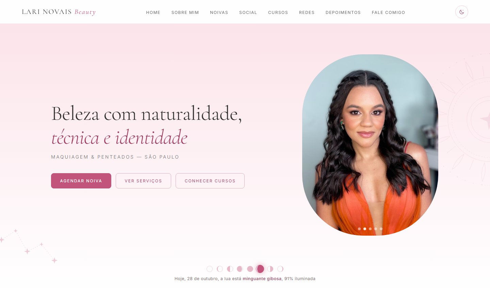
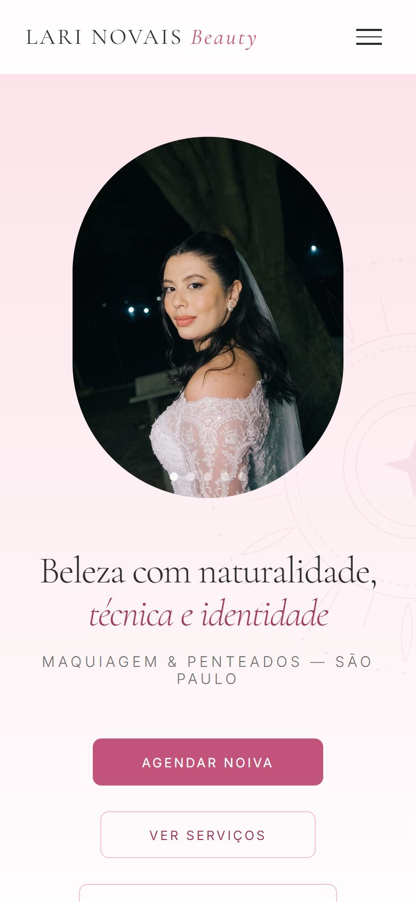
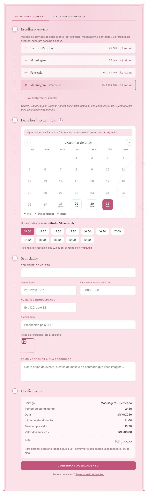

# Lari Novais Beauty — Site

Site institucional da maquiadora e penteadista Lari Novais, de São Paulo, com **agendamento online** e o **painel da profissional** integrados à API de agendamento ([lari-novais-beauty-agendamento](https://github.com/araujogbs/lari-novais-beauty-agendamento), que também tem o app).

**No ar em [larinovaisbeauty.com.br](https://larinovaisbeauty.com.br)** (Cloudflare), com a API em `https://api.larinovaisbeauty.com.br`.

<p align="center"></p>

<table>
  <tr>
    <td align="center" valign="top" width="25%"><br /><sub>No celular</sub></td>
    <td align="center" valign="top" width="37%"><br /><sub>Agendamento online: horários livres, taxa por CEP e resumo</sub></td>
    <td align="center" valign="top" width="38%"><br /><sub>Painel da Lari: aprovar, recusar e agenda do dia (dados fictícios)</sub></td>
  </tr>
</table>

## Destaques técnicos

- **React 19 + TypeScript em modo strict + Vite**, com ESLint (`typescript-eslint` strict type-checked), Prettier e testes com Vitest + Testing Library. `npm run check` roda tudo de uma vez.
- **Agendamento online integrado à API:** horários livres em tempo real, taxa de deslocamento pelo CEP, quantidade de pessoas, fotos de referência e envio em `multipart/form-data`. Se a API cair, o widget oferece o WhatsApp e o resto do site continua funcionando.
- **Painel da profissional carregado sob demanda** (`React.lazy`) em `/#painel`: quem só visita o site não baixa esse código. A sessão fica no `sessionStorage` e volta ao login quando o token expira.
- **Formulários sem back-end próprio:** montam a mensagem e abrem o WhatsApp com o texto pronto.
- **Datas sempre no fuso de Brasília**, independente do fuso do aparelho de quem acessa.
- **Céu interativo:** constelações que se desenham com a rolagem, sóis e luas que giram conforme a página desce, a fase real da lua no dia e um **modo noturno** com céu estrelado (canvas). Tudo respeita o "menos movimento" do aparelho.
- **Calendário de disponibilidade:** o agendamento mostra quais dias estão livres, com últimos horários ou lotados, numa única chamada à API, e oferece salvar o pedido no Google Agenda ou num arquivo `.ics`.
- **Pronto para compartilhar:** Open Graph com imagem própria (prévia no WhatsApp e no Instagram), dados estruturados `BeautySalon` para o Google, favicon e `robots.txt`.

---

## Sobre o site

Site institucional de uma maquiadora e penteadista profissional que atende a domicílio (São Paulo). Apresenta a profissional, os serviços de **noivas**, **atendimento social** e **cursos**, reúne depoimentos de clientes e converte visitas em contato por **WhatsApp**. O Atendimento Social tem **agendamento online** integrado à AgendamentoApi, do repositório [lari-novais-beauty-agendamento](https://github.com/araujogbs/lari-novais-beauty-agendamento) (localmente, na pasta `../API e App`).

- **Tipo:** site de uma página (one-page) em **React + TypeScript**, com build e servidor de desenvolvimento do **Vite**.
- **Fontes:** Cormorant Garamond e Inter (Google Fonts).
- **Conteúdo:** segue o documento `INFORMAÇÕES SITE.docx`, que é a referência de textos, preços e estrutura.

---

## Sumário

1. [Estrutura do projeto](#estrutura-do-projeto)
2. [Seções do site](#seções-do-site)
3. [Formulários e WhatsApp](#formulários-e-whatsapp)
4. [Céu interativo e modo noturno](#céu-interativo-e-modo-noturno)
5. [Agendamento online (Atendimento Social)](#agendamento-online-atendimento-social)
6. [Como rodar localmente](#como-rodar-localmente)
7. [Configuração](#configuração)
8. [Como editar o conteúdo](#como-editar-o-conteúdo)
9. [Publicação](#publicação)
10. [Limitações conhecidas e próximos passos](#limitações-conhecidas-e-próximos-passos)

---

## Estrutura do projeto

```
Site/
├── index.html                 # <head> com SEO, Open Graph e dados estruturados, e o <div id="root">
├── src/
│   ├── main.tsx               # Ponto de entrada (StrictMode + CSS)
│   ├── App.tsx                # Monta as seções na ordem da página e aplica o tema (dia/noite)
│   ├── components/            # Uma seção por componente (Hero, AboutMe, Brides, Courses…)
│   │   ├── Nav.tsx · HeroCarousel.tsx · ReviewsCarousel.tsx   # partes interativas (o Nav tem o botão de modo noturno)
│   │   ├── BrideForm.tsx · ContactForm.tsx                    # formulários -> WhatsApp
│   │   ├── Constellation.tsx      # constelação da seção, desenhada pela rolagem, com o botão de estrela
│   │   ├── CelestialSprites.tsx   # sóis, luas e constelações do fundo (giram com a rolagem)
│   │   ├── MoonToday.tsx          # a lua de hoje no hero
│   │   └── SkyEffects.tsx         # céu estrelado do modo noturno e chuva de estrelinhas
│   ├── agendamento/           # Widget de agendamento online (Atendimento Social)
│   │   ├── AgendamentoWidget.tsx   # abas e estado geral
│   │   ├── NewBooking.tsx          # passos 1-4 e envio
│   │   ├── AvailabilityCalendar.tsx # calendário do mês com dias livres, últimos horários e lotados
│   │   ├── MyAppointments.tsx      # consulta e cancelamento por telefone
│   │   ├── BookingDone.tsx         # tela de confirmação, com Google Agenda e .ics
│   │   ├── booking.ts              # validação, regras de fotos e montagem do multipart (puro)
│   │   ├── calendar.ts             # grade do mês, rótulos de disponibilidade, link do Google Agenda e .ics (puro)
│   │   ├── api.ts · types.ts       # chamadas à AgendamentoApi e tipos
│   │   └── useAsync.ts · useServices.ts   # hooks de busca
│   ├── painel/                # Painel Ateliê da Lari (/#painel): login, pedidos em análise, agenda, bloqueios
│   ├── data/                  # Conteúdo em dados: depoimentos, fotos do hero, links do menu, constelações
│   ├── lib/                   # moon.ts (fase da lua) e motion.ts ("menos movimento", estrela de 4 pontas)
│   ├── hooks/                 # useReveal (animação .reveal), useScrolled (menu), useHash (abre o painel), useTheme (modo noturno)
│   ├── whatsapp.ts            # Montagem das mensagens e links do WhatsApp
│   ├── config.ts · utils.ts   # Variáveis VITE_* e utilitários (máscaras, datas, valores)
│   ├── styles/main.css        # Todos os estilos
│   └── **/*.test.ts(x)        # Testes (Vitest + Testing Library)
├── public/img/                # Imagens otimizadas usadas pelo site (hero, home, cursos, Lari)
├── public/og-image.jpg · favicon.svg · robots.txt   # prévia de link (1200 x 630), ícone e robôs de busca
├── .env.example               # Modelo das variáveis de ambiente
├── .env.development · .env.production   # usados por `npm run dev` e `npm run build`
├── package.json · tsconfig.json · vite.config.ts
├── eslint.config.js · .prettierrc.json · .editorconfig
├── INFORMAÇÕES SITE.docx      # Documento de conteúdo (fonte dos textos)
└── README.md
```

Os arquivos de `public/` são copiados como estão para o `dist/` e referenciados por `/img/...` no HTML. As fotos originais ficam fora do site, na pasta `Fotos do site/` do projeto: otimize a imagem (até 1200 px, JPG) antes de colocar em `public/img/`.

---

## Seções do site

A navegação fixa no topo tem: **Home · Sobre Mim · Noivas · Social · Cursos · Redes · Depoimentos · Fale Comigo**, mais o botão de **modo noturno**. No celular vira menu hambúrguer.

| Seção | Âncora | O que tem |
|---|---|---|
| **Home** | `#home` | Hero com carrossel automático de fotos (troca a cada 4 s), título que aparece palavra por palavra, botões e **a lua de hoje**. Em seguida: portfólio em 3 blocos (Noivas, Eventos Sociais, Cursos), apresentação "Olá, eu sou a Lari" (sem o título "Quem sou eu"), cartões de serviços |
| **Depoimentos** | `#depoimentos` | Carrossel com as 7 avaliações reais do documento. **Só existe na Home** |
| **Sobre Mim** | `#sobre` | Constelação **Lyra**. "A artista por trás dos pincéis": trajetória em texto e currículo (Senac, Anhembi Morumbi, Style Academy, Visagismo, O Poder da Juba e especializações) |
| **Noivas** | `#noivas` | Constelação **Corona Borealis**. Frase de posicionamento, "Do primeiro contato ao altar" em 6 passos, galeria de inspirações, pacote único ("a partir de R$ 3.000,00") e formulário da noiva |
| **Atendimento Social** | `#social` | Constelação **Plêiades**. Texto de posicionamento, galeria, tabela de preços, **agendamento online** e carrossel "Avaliações no Google" |
| **Cursos** | `#cursos` | Constelação **Cruzeiro do Sul**. Três cursos Beauty Class (Automaquiagem, Penteado Profissional, Maquiagem Profissional), cada um com botão "Quero me Inscrever" que abre o WhatsApp |
| **Redes** | `#redes` | Instagram, TikTok e YouTube, com os links reais |
| **Fale Comigo** | `#contato` | Formulário de sugestões, elogios e parcerias, mais WhatsApp, e-mail e redes |

### Conteúdo oculto
- **Equipe:** a seção completa (`#equipe`) e o bloco "Redes" da Home estão com o atributo `hidden`, e o link "Equipe" saiu do menu. Para exibir de novo, remova `hidden` da `<section>` correspondente.
- **Depoimentos de noivas e de clientes sociais:** removidos de propósito. Está previsto gravar vídeos curtos de depoimento no futuro.

### Preços (Atendimento Social)
| Item | Valor |
|---|---|
| Pacote Maquiagem + Penteado | R$ 700,00 |
| Maquiagem (unitário) | R$ 350,00 |
| Penteado (unitário) | R$ 350,00 |
| Escova e Babyliss | R$ 300,00 |

A taxa de deslocamento é cobrada à parte, conforme o endereço. Cursos: Automaquiagem R$ 500,00 (4 h); Penteado Profissional (20 h) e Maquiagem Profissional (6 h) com valores sob consulta.

---

## Formulários e WhatsApp

Todos os contatos usam o número **(11) 91483-4786** (`5511914834786` nos links `wa.me`). Os formulários não enviam dados a nenhum servidor: montam uma mensagem formatada e abrem o WhatsApp da visitante com o texto pronto.

| Formulário | Campos | Componente |
|---|---|---|
| **Noivas** ("Vamos conversar sobre o seu casamento") | Nome da noiva, data do casamento, local do evento, mensagem | `BrideForm.tsx` |
| **Fale Comigo** | Nome, e-mail, assunto (Sugestão, Elogio, Parceria, Outro), mensagem | `ContactForm.tsx` |
| **Cursos** | Sem formulário: o botão abre o WhatsApp com "Quero me inscrever no curso …" | link direto |

Os valores digitados são enviados pela URL com `encodeURIComponent`. Datas saem em formato dd/mm/aaaa. A montagem das mensagens fica em `src/whatsapp.ts` (com testes). O e-mail de contato exibido é `larinovaisbeauty@gmail.com`.

---

## Céu interativo e modo noturno

O tema celeste do site (sóis e luas de tarô) ganhou movimento:

| Recurso | Como funciona | Onde |
|---|---|---|
| **Constelações das seções** | No canto superior de Sobre mim, Noivas, Social e Cursos, cada uma com nome e apelido ("a constelação da noiva"…). As linhas ligam as estrelas uma a uma conforme a seção sobe pela tela. O **botão de estrela** ao lado conta a história dela (mouse, foco ou toque). Em telas menores que 1240 px ficam pequenas acima do título | `Constellation.tsx`, textos em `data/constellations.ts` |
| **Sóis e luas do fundo** | Giram conforme a página rola (as luas no sentido contrário), além do giro lento de sempre | `CelestialSprites.tsx` |
| **A lua de hoje** | Fase calculada de verdade (mês sinódico a partir de uma lua nova de referência), desenhada como se vê do Brasil: "Hoje, 19 de outubro, a lua está em quarto crescente, 55% iluminada" | `MoonToday.tsx`, `lib/moon.ts` |
| **Modo noturno** | Botão de lua/sol no menu. Fundo azul-noite, céu estrelado em canvas, rosa mais luminoso e desenhos em dourado. Segue o modo escuro do aparelho até a visitante escolher, e lembra a escolha (`localStorage`). O painel da Lari fica sempre claro | `hooks/useTheme.ts`, `SkyEffects.tsx`, tokens em `:root[data-theme='dark']` |
| **Hero** | Título que aparece palavra por palavra | `Hero.tsx` |
| **Botões principais** | Um brilho dourado atravessa os botões rosa de tempos em tempos | `.btn-primary::after` |
| **Chuva de estrelinhas** | Ao concluir um agendamento | `sparkleBurst` em `lib/motion.ts` |

**Menos movimento:** quem ativou "reduzir movimento" no aparelho (no Windows, *Efeitos de animação* desligado) vê tudo parado: constelações já desenhadas, sem giro, sem brilho e sem a entrada do título. Para testar as animações, deixe essa opção desligada.

---

## Agendamento online (Atendimento Social)

O widget (`src/agendamento/`) conversa com a **AgendamentoApi** (.NET). Noivas **não** usa agendamento online, apenas o formulário de WhatsApp.

**Fluxo da cliente**
1. Escolhe o **serviço** (lista, duração e preço vêm de `GET /api/services`).
2. Escolhe o **dia num calendário do mês** que marca cada dia como **livre**, **últimos horários** (até 3 horários de início) ou **lotado** (não dá para escolher), com uma única chamada a `GET /api/appointments/availability`. No celular pequeno, o rótulo vira um ponto colorido. Os **horários livres** do dia vêm de `GET /api/appointments/available-slots`. Se a disponibilidade não carregar, o calendário avisa e continua deixando escolher o dia.
3. Preenche nome, WhatsApp (com máscara), horário de início (o símbolo "i" ao lado do título explica como escolher), CEP, número, quantidade de pessoas, descrição e **fotos de referência** (até 5, JPG/PNG/WebP, 5 MB cada, com miniaturas e botão para remover).
4. Ao completar o **CEP**, o endereço é preenchido e a **taxa de deslocamento** é calculada (`GET /api/appointments/estimate-fee`). O resumo mostra serviço, deslocamento e total.
5. Confirma (`POST /api/appointments`, formulário multipart). O horário é enviado em fuso de Brasília (`-03:00`). Na tela de confirmação há os botões **Google Agenda** (link de evento pronto) e **Apple / Outlook** (baixa um `.ics`, com o horário em UTC para abrir certo em qualquer agenda).
6. Em **Meus agendamentos**, busca pelo WhatsApp, vê o status ("Em análise" ou "Confirmado") e cancela: pedido em análise a qualquer momento, confirmado com mais de 24 h de antecedência (`my-appointments` e `client-cancel`).

O horário escolhido é o de **início** (`startTime`); a API calcula o término somando a duração total (serviço × pessoas), e o resumo mostra o término previsto. Ao enviar, a cliente vê "Agendamento em análise": o pedido segura o horário até a Lari aprovar ou recusar no painel (prazo de 3 dias, depois expira), e a resposta chega pelo WhatsApp. A quantidade de pessoas (`people`) multiplica o valor do serviço e a duração, mas não o deslocamento.

**Se a API estiver indisponível:** o widget mostra um aviso e um link "Agendar pelo WhatsApp"; o resto do site não é afetado.

**Regras que vêm do backend** (não do site): expediente das 6h às 22h, sem sobreposição de horários, aprovação dos pedidos e prazo de 3 dias, cancelamento de confirmados só com mais de 24 h, limites de requisições por IP (resposta 429) e cálculo de deslocamento a partir do CEP. Detalhes no README da AgendamentoApi.

### Serviços cadastrados na API
| Serviço | Duração | Preço |
|---|---|---|
| Maquiagem | 60 min | R$ 350 |
| Penteado | 90 min | R$ 350 |
| Escova e Babyliss | 60 min | R$ 300 |
| Maquiagem + Penteado | 150 min | R$ 700 |

Em produção foram cadastrados pelo `deploy/seed-servicos.sql` da API; no banco local, ajustados pela migration `AtualizarServicosSocial`. Os ids mudam de um banco para o outro, por isso o site sempre lê a lista da API.

As durações são estimativas e devem ser ajustadas ao tempo real de atendimento.

---

## Painel Ateliê (área da Lari)

A mesma gestão do app, no navegador. Abre pelo endereço **`/#painel`** (não há link no site). O login é o mesmo do app (`Admin:Username` / senha da API).

- **Pedidos em análise** (de qualquer data) com **Aprovar** e **Recusar** (motivo opcional, enviado à cliente) e o prazo para responder: sem resposta em 3 dias, a API expira o pedido e libera o horário.
- **Agenda do dia** com navegação entre dias: serviço, horário, WhatsApp, endereço, valores, descrição e **fotos de referência** (baixadas com o token e ampliáveis).
- Atalhos de **WhatsApp** e **mapa**, **Desmarcar** atendimento confirmado e **Bloquear/Desbloquear** agenda (dia inteiro ou intervalo).
- **Mensagem pronta pelo WhatsApp da Lari:** depois de aprovar ou recusar, o aviso traz o botão "Enviar pelo WhatsApp" (confirmação com sinal e PIX, ou recusa com o motivo); atendimentos confirmados têm "Enviar PIX" / "Enviar confirmação" para reenviar.
- **Aviso de pedido novo (push no navegador):** o bloco "Receber aviso de pedido novo" liga e desliga a notificação neste aparelho. Com o painel aberto, a lista também se atualiza sozinha quando chega o aviso.

#### Aviso de pedido novo no iPhone

O iPhone (iOS 16.4 ou mais novo) só recebe push de site **instalado na Tela de Início**: no Safari, abrir `/#painel`, tocar em Compartilhar → Adicionar à Tela de Início e abrir pelo ícone "Painel Lari"; dentro do painel instalado, tocar em **Ativar avisos** e permitir as notificações. No Safari comum o bloco só mostra essas instruções.

Peças: `public/sw.js` (service worker: mostra a notificação, atualiza a lista e abre o painel ao tocar; precisa mostrar **toda** notificação, senão o iOS cancela a assinatura), `public/manifest.webmanifest` e os ícones `painel-icon-*.png` (o manifesto e o ícone só são injetados no `<head>` enquanto o painel está aberto, em `AdminPanel.tsx`), `src/painel/webPush.ts` e `PushToggle.tsx`. A API (`/push/web/*`, chaves VAPID em `VAPID_PUBLIC_KEY`/`VAPID_PRIVATE_KEY`) guarda as assinaturas e envia o push a cada pedido novo; sem as chaves o bloco falha com "indisponível".

Código em `src/painel/`, carregado sob demanda (`React.lazy`): quem só visita o site não baixa o painel. O token fica no `sessionStorage` (some ao fechar a aba) e, quando expira (2 h) ou a API responde 401, o painel volta para o login. Enquanto aberto, a página recebe `noindex`.

Em produção, o domínio do site precisa estar em `Cors:AllowedOrigins` na API (o painel usa o header `Authorization`, já liberado).

---

## Como rodar localmente

### Só o site
Requer Node 18+.

```bash
npm install
npm run dev        # http://localhost:5173
npm run typecheck  # checagem de tipos (strict)
npm run lint       # ESLint (typescript-eslint strict)
npm run format     # Prettier
npm test           # testes (Vitest)
npm run check      # typecheck + lint + format + testes
npm run build      # gera dist/ (tsc + vite build)
npm run preview    # serve o dist/ localmente
```

Sem a API no ar, o site funciona normalmente, só o widget de agendamento mostra o aviso de indisponibilidade.

### Com o agendamento
1. Suba o PostgreSQL e a API (veja o README da AgendamentoApi):
   ```bash
   cd "../API e App/AgendamentoApi"
   dotnet run --launch-profile http   # http://localhost:5102
   ```
2. Confirme que `VITE_AGENDAMENTO_API` (em `.env.development`) aponta para `http://localhost:5102/api`.
3. Rode `npm run dev` e vá até o Atendimento Social.

Em desenvolvimento a API aceita qualquer origem (CORS aberto). Em produção só aceita as origens listadas em `Cors:AllowedOrigins`.

---

## Configuração

Variáveis de ambiente do Vite (modelo em `.env.example`; `npm run dev` lê o `.env.development`; **`npm run build` lê o `.env.production`**, que já aponta para `larinovaisbeauty.com.br`; ajuste se o domínio for outro):

```
VITE_AGENDAMENTO_API=https://api.larinovaisbeauty.com.br/api   # URL pública (HTTPS) da AgendamentoApi
VITE_WHATSAPP=5511914834786                                     # WhatsApp dos formulários e do plano B do widget
VITE_SITE_URL=https://larinovaisbeauty.com.br                   # endereço do site, usado no Open Graph e no canonical
```

`VITE_SITE_URL` e `VITE_WHATSAPP` também são substituídas no `index.html` (`%VITE_SITE_URL%`): a prévia de link do WhatsApp e do Instagram precisa de endereços completos.

As variáveis são embutidas no build: ao mudá-las, rode `npm run build` de novo. Os links `wa.me` escritos direto em `src/components/Courses.tsx` (botões de curso) continuam com o número fixo; para trocar de número, faça uma busca e substituição nesse arquivo.

---

## Como editar o conteúdo

- **Textos:** edite o componente da seção em `src/components/` (por exemplo, a Trajetória está em `AboutMe.tsx`). Ele é JSX: `class` vira `className` e `style` é um objeto.
- **Depoimentos e avaliações:** ficam em `src/data/reviews.ts`. O mesmo conteúdo alimenta o carrossel da Home e o do Google. Para as avaliações do Google serem reais, será preciso integrar com a API do Google Places ou copiar os textos manualmente.
- **Cursos:** cada curso é um bloco `.curso-card` em `src/components/Courses.tsx`; o link do botão é um `wa.me` com o nome do curso já codificado.
- **Fotos:** coloque as imagens já otimizadas em `public/img/` e referencie por `/img/...`. Atenção ao peso (veja abaixo).
- **Cores e tipografia:** variáveis CSS em `:root` no topo de `src/styles/main.css` (`--rose`, `--rose-dark`, `--cream`…). O modo noturno redefine as mesmas variáveis em `:root[data-theme='dark']`. Use `--surface` para fundos e `--on-rose` para texto sobre rosa (não `--white`, que é branco fixo para texto sobre fotos).
- **Constelações:** nome, apelido, texto do botão de estrela e posição das estrelas ficam em `src/data/constellations.ts`. O lado (esquerda ou direita) é a prop `side` em cada seção.
- **Prévia de link e Google:** título, descrição e dados do negócio ficam no `index.html`; a imagem é `public/og-image.jpg` (1200 x 630).
- **Preços do Social:** estão em dois lugares, no cartão de preços de `src/components/SocialService.tsx` e nos serviços da API. Atualize os dois.

---

## Publicação

O site está no ar em **[larinovaisbeauty.com.br](https://larinovaisbeauty.com.br)**, publicado pelo **Cloudflare Workers** (arquivos estáticos, gratuito) ligado a este repositório: **cada push na `master` publica sozinho**. Não há passo manual de deploy.

| Item | Configuração |
|---|---|
| Build | `npm run build`, saída `dist`, Node 22 (`.node-version`) |
| Domínio | `larinovaisbeauty.com.br` ligado ao Worker; `www` redireciona (301) para o domínio principal por uma Redirect Rule da Cloudflare |
| DNS | Cloudflare, com DNSSEC; o domínio é registrado no registro.br |
| Cabeçalhos | `public/_headers`: segurança (HSTS, `X-Frame-Options`, `nosniff`, Referrer e Permissions Policy) e cache longo de `/assets/*` (arquivos com hash no nome) |
| API | `https://api.larinovaisbeauty.com.br`, com CORS liberado só para o domínio do site (veja o README da API) |

A navegação é por hash (`#painel`), então não precisa configurar rewrite. Ao mudar o domínio ou o WhatsApp, ajuste o `.env.production`: as variáveis são embutidas no build.

Para publicar em outra hospedagem, basta servir a pasta `dist/` (Netlify, Vercel, Cloudflare Pages, hospedagem comum); o `_headers` só vale na Cloudflare e na Netlify.

---

## Limitações conhecidas e próximos passos

- **Mensagens de WhatsApp e eventos do Google Agenda ainda em simulação na API** (a cliente vê a confirmação na tela, mas não recebe mensagem automática). Integração com a API oficial da Meta em andamento.
- **Imagens sem versões responsivas (`srcset`).** Todas ficam em `public/img/` (cerca de 3 MB no total), mas o celular baixa o mesmo arquivo que o computador.
- **Avaliações do Google copiadas à mão:** os 7 textos vêm do perfil real (todas 5 estrelas) e o selo "5,0" é fixo; não há integração automática com o Google (a Places API traz só 5 avaliações e exige chave e endpoint no servidor).
- **Seção Equipe e bloco de redes da Home estão ocultos**; os nomes e descrições da Equipe são de exemplo.
- **Cartões de Instagram e TikTok** na seção Redes trazem listas de exemplo ("Antes e depois de noivas", "Penteado em 60 segundos") que não vêm do documento.
- **Conteúdo do portfólio** da Home e rótulos das fotos são genéricos; vale revisar com a cliente.
- **Horário de atendimento da API é fixo** (6h às 22h, constantes `WorkStart`/`WorkEnd` no `AppointmentsController`).
- **Fuso:** o widget envia o horário com `-03:00` fixo, o que está correto enquanto o Brasil não adotar horário de verão.
- **"Meus agendamentos" funciona por código secreto, não por telefone.** Cada pedido gera um código (`id.assinatura`) que o navegador guarda e que também vai num link de WhatsApp (`/#ag=código`). Quem só sabe o telefone de alguém não vê nada. Limitação: em outro aparelho, só pelo link do WhatsApp (depende da integração oficial) ou falando com a Lari.
- **Analytics:** Cloudflare Web Analytics em configuração automática (sem cookies). `sitemap.xml` e `robots.txt` já estão no ar.
- **Antes e depois** (slider de comparação) ficou para depois: depende de pares de fotos reais.
- **Acessibilidade:** o menu e os carrosséis precisam de revisão (foco por teclado, textos alternativos mais descritivos, contraste dos rótulos rosa claro).
- Ideias: vídeos curtos de depoimento, blog, integração real com o Google Reviews, lembretes de agendamento.
